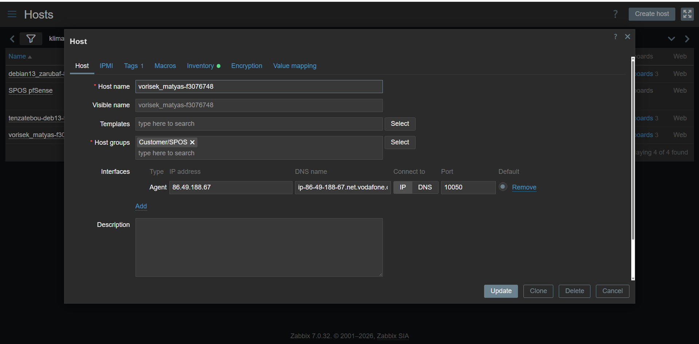
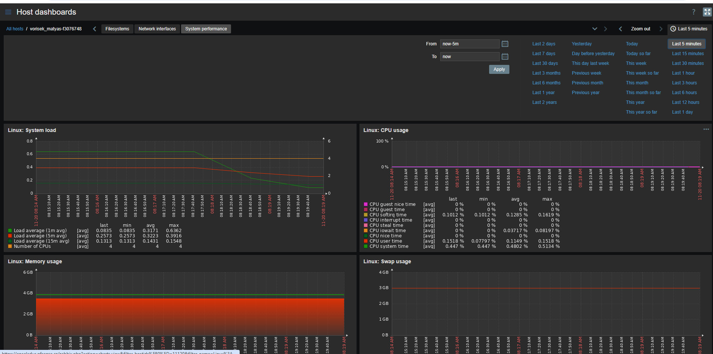

# Automatická registrace Debianu 13 do Zabbixu 8.0 LTS


Školní projekt do předmětu **OSY**. Cílem je automaticky rozjet virtuální server s **Debianem 13** pomocí Vagrantu, nainstalovat na něj **Zabbix Agent 2 (8.0 LTS)** a propojit ho se Zabbix serverem `enceladus.pfsense.cz` přes funkci Auto-registration.

---

## Jak to funguje

Celé nasazení je plně automatizované přes Vagrant provisioning:

1. **Vytvoření VM (`Vagrantfile`)** – spustí virtuální stroj s Debianem 13 a předá mu instalační a konfigurační skripty.
2. **Instalace agenta (`zabzab-agent-install.sh`)** – přidá oficiální repozitář Zabbix 8.0 pro Debian 13 a nainstaluje balíček `zabbix-agent2`.
3. **Konfigurace a registrace (`zabzab-agent-conf.sh`)** – nastaví stálý jedinečný `Hostname` (přežije restart i opakovaný provisioning), nasměruje agenta na `enceladus.pfsense.cz` s metadaty `HostMetadata=SPOS` a spustí službu.

---

## Rychlé spuštění

```bash
git clone https://github.com
cd joyik08-osy-2026-zbx8-auto-reg
vagrant up
```

*(Pokud upravíš skripty a chceš změny aplikovat znovu bez mazání VM, použij `vagrant provision`.)*

---

## Kontrola ve virtuálním stroji

Po připojení přes `vagrant ssh` si můžeš ověřit, že vše běží tak, jak má:

```bash
zabbix_agent2 -V              # kontrola verze 8.0
systemctl status zabbix-agent2 # kontrola běžící služby
```

---

## MOJE VĚTA

Všechno bylo za mě jednoduchý a dost rychlý protože práci kterou jsme měli dělat jsem si dělal už před asi 3 týdnama.

---

## Výsledek v Zabbixu

Po spuštění agenta se server sám přihlásil do Zabbixu, zařadil se do příslušné skupiny a získal Linux šablonu:



A zde už jsou vidět reálná monitorovací data přicházející z virtuálního stroje:



---

## Přehled souborů

| Soubor / Složka | Popis |
| :--- | :--- |
| `Vagrantfile` | Konfigurace virtuálního stroje (Debian 13) a spuštění provisioningu |
| `zabzab-agent-install.sh` | Instalace Zabbix Agent 2 z oficiálního repozitáře |
| `zabzab-agent-conf.sh` | Nastavení `/etc/zabbix/zabbix_agent2.conf` a restart agenta |
| `Images/` | Screenshoty potvrzující registraci a funkční monitoring |
